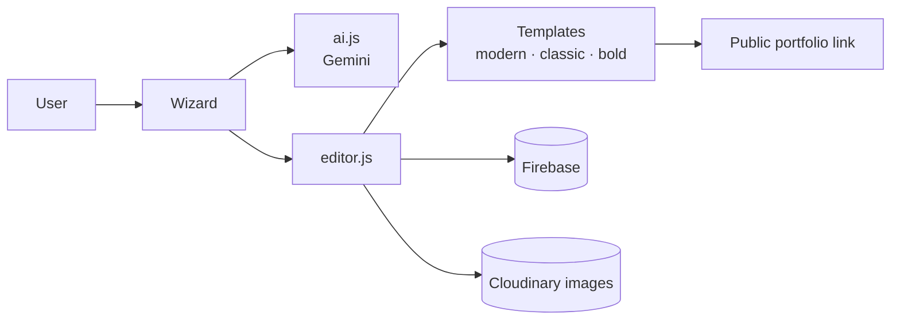

<div align="center">

# 🚀 Portfolio Architect Pro

### AI-assisted portfolio builder — guided 6-step wizard, three templates, cloud storage and one-click publishing

     

[](LICENSE)    

[](https://codespaces.new/shiroonigami23-ui/student-portfolio?quickstart=1) [](https://github.com/shiroonigami23-ui/student-portfolio/archive/refs/heads/main.zip)

[**🚀 Live Demo**](https://shiroonigami23-ui.github.io/student-portfolio/) · [**Overview**](#-overview) · [**Features**](#-features) · [**Architecture**](#-architecture) · [**Getting Started**](#-getting-started) · [**Roadmap**](#-roadmap)

</div>

---

## 📖 Overview

**Portfolio Architect** helps students and professionals build a polished portfolio in minutes. A **six-step wizard** collects basics, experience, education, skills and more; an **AI text enhancer** rewrites descriptions, generates bullet points and fixes grammar, and a **first-draft generator** produces a whole starting portfolio from a role description. Choose from **Modern, Classic or Bold** templates, store images on **Cloudinary**, save to **Firebase**, and share a live link.

### ✨ Highlights

- **AI writing assistant** and first-draft generator
- **3 templates** — modern, classic, bold
- **Cloud persistence** with Firebase + Cloudinary
- **Live** at [shiroonigami23-ui.github.io/student-portfolio](https://shiroonigami23-ui.github.io/student-portfolio/)

## 🧩 Features

| Feature | What it does |
|---|---|
| **Wizard** | 6 guided sections |
| **AI enhancer** | Improve text, bullets, grammar (`ai.js`) |
| **Draft generator** | Portfolio from a role prompt |
| **Templates** | `templates/modern.js`, `classic.js`, `bold.js` |
| **Editor** | `editor.js` live editing |
| **Storage** | `firebase.js`, `storage.js`, `cloudinary.js` |
| **Validation** | `validator.js` |
| **Notifications** | `notifications.js` |

## 🛠 Tech Stack

| Layer | Technology |
|---|---|
| Front-end | Vanilla JavaScript, HTML, CSS |
| AI | Gemini API |
| Backend | Firebase |
| Media | Cloudinary |
| Hosting | GitHub Pages |

## 🏗 Architecture




➡️ Full design notes, data flow and design decisions: **[docs/ARCHITECTURE.md](docs/ARCHITECTURE.md)**

## 📁 Project Structure

```text
student-portfolio/
├── index.html · app.js · ui.js · modal.js
├── ai.js · editor.js · portfolio.js · validator.js · notifications.js
├── firebase.js · storage.js · cloudinary.js · config.js
└── templates/{modern,classic,bold}.js
```

## 🚀 Getting Started

### 1. Get the code

Pick whichever method suits you:

| Method | Command |
|---|---|
| **HTTPS** | `git clone https://github.com/shiroonigami23-ui/student-portfolio.git` |
| **SSH** | `git clone git@github.com:shiroonigami23-ui/student-portfolio.git` |
| **GitHub CLI** | `gh repo clone shiroonigami23-ui/student-portfolio` |
| **ZIP** | [Download](https://github.com/shiroonigami23-ui/student-portfolio/archive/refs/heads/main.zip) and extract |
| **Codespaces** | [Open in browser](https://codespaces.new/shiroonigami23-ui/student-portfolio?quickstart=1) — zero local setup, dev container preconfigured |

> 🔑 **Using SSH for the first time?** Generate a key with `ssh-keygen -t ed25519 -C "you@example.com"`, add the `.pub` contents at **GitHub → Settings → SSH and GPG keys**, then test with `ssh -T git@github.com`.

### 2. Install & set up

```bash
cd student-portfolio
python3 -m http.server 8080      # configure keys in config.js first
```

### 3. Run

Or use the live app: **https://shiroonigami23-ui.github.io/student-portfolio/**

## 🗺 Roadmap

**v1 (done)**

- [x] Wizard, AI enhancer, templates, cloud save

**v1.1**

- [ ] PDF résumé export
- [ ] Custom domains
- [ ] More templates

**v2.0**

- [ ] GitHub/LinkedIn import
- [ ] Analytics on portfolio views

➡️ Detailed plan, milestones and long-term vision: **[docs/ROADMAP.md](docs/ROADMAP.md)**

## 🤝 Contributing

Contributions, issues and feature requests are welcome!

1. Fork the repository
2. Create a feature branch: `git checkout -b feature/amazing-feature`
3. Commit your changes: `git commit -m "feat: add amazing feature"`
4. Push the branch: `git push origin feature/amazing-feature`
5. Open a Pull Request against `main`

Check the [issues page](https://github.com/shiroonigami23-ui/student-portfolio/issues) and the [roadmap](docs/ROADMAP.md) for ideas on where to help.

## 📜 Changelog

See [CHANGELOG.md](CHANGELOG.md) for the release history.

## 📄 License

Distributed under the **MIT** license. See [LICENSE](LICENSE) for details.

## 👤 Author

**Aryan Singh Chandel** (Shiro)

[](https://github.com/shiroonigami23-ui)

<div align="center">

⭐ **If you find this project useful, consider giving it a star!** ⭐

</div>
