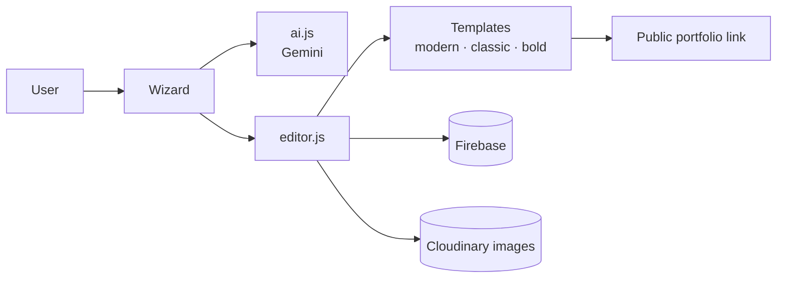

# 🏗 Architecture — Portfolio Architect Pro

> Part of [student-portfolio](https://github.com/shiroonigami23-ui/student-portfolio). Back to the [README](../README.md).

## 1. System Overview

A modular vanilla-JS app: the wizard collects data, the editor renders it through a chosen template, and storage modules persist to Firebase/Cloudinary.

## 2. Components

| Component | Location | Responsibility |
|---|---|---|
| **UI** | `app.js, ui.js` | Wizard and navigation |
| **AI** | `ai.js` | Gemini prompts |
| **Rendering** | `templates/` | Portfolio layouts |
| **Data** | `firebase.js, storage.js` | Persistence |

## 3. Data / Control Flow

1. Fill wizard steps.
2. Enhance with AI.
3. Pick template, save and share.

## 4. Key Design Decisions

| Decision | Rationale |
|---|---|
| Templates as modules | Easy to add new designs |

## 5. Known Limitations

- Requires API keys in config.js

---
*Last updated: 2026-11-14*
